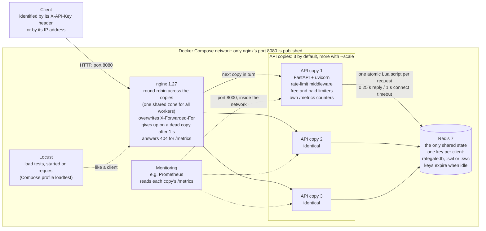
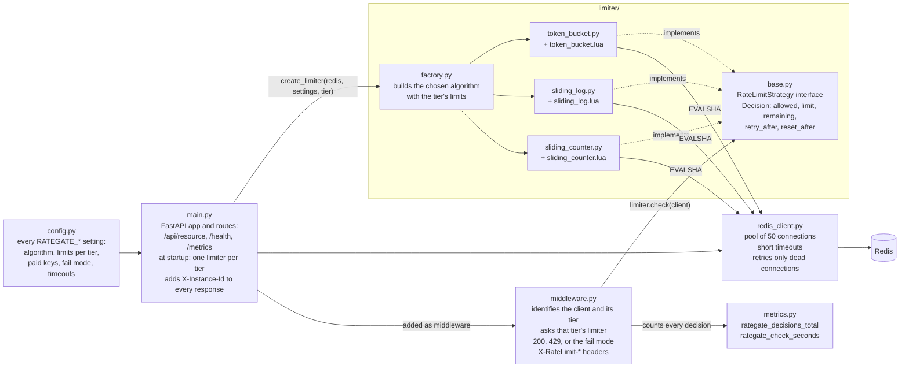
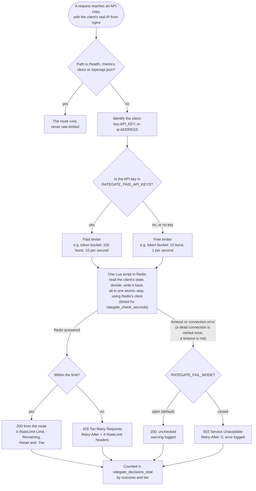

# RateGate

[](https://github.com/diyalibiswas1998/RateGate/actions/workflows/ci.yml)

A distributed rate-limiting service built with FastAPI and Redis. Every API instance checks limits against the same Redis, using atomic Lua scripts, so a client's limit holds no matter which instance answers.

Over the limit, clients get `429 Too Many Requests` with a `Retry-After` header. Every response carries `X-RateLimit-Limit`, `X-RateLimit-Remaining`, `X-RateLimit-Reset` and `X-RateLimit-Tier`.

## Architecture

### The system



The copies keep no state of their own, so any copy can answer any request, and adding copies adds capacity (see Load testing). Redis runs each script on its own, so no two copies can interleave a client's read and write.

### Inside one API copy



Only the algorithm classes know about Redis keys and scripts; the middleware only knows the `RateLimitStrategy` interface, so switching algorithms is one setting (`RATEGATE_ALGORITHM`).

### How one request is checked



Every response, including `429` and `503`, also carries `X-Instance-Id`, naming the copy that answered.

## Run it

Requires [uv](https://docs.astral.sh/uv/) and Docker.

```bash
docker run -d -p 6379:6379 --name redis redis:7
uv sync
uv run uvicorn app.main:app --reload
```

Then call `http://127.0.0.1:8000/api/resource`. Clients are identified by the `X-API-Key` header, or by IP address if it's missing.

Run the tests (Redis must be running):

```bash
uv run pytest
```

On Windows with Docker Desktop, Redis replies can be delayed under bursts, beyond the production timeouts. Give this machine its own values in a `.env` file (never committed; the containers don't read it):

```
RATEGATE_REDIS_SOCKET_TIMEOUT=1.0
RATEGATE_REDIS_CONNECT_TIMEOUT=1.5
```

## Run the full stack (3 copies behind nginx)

```bash
docker compose up --build -d --wait
```

This starts Redis, three copies of the API and nginx, which spreads requests across the copies in turn. Call `http://127.0.0.1:8080/api/resource`: the `X-Instance-Id` header names the copy that answered, while every copy checks the same Redis, so a client is limited once, globally.

```bash
uv run python scripts/sequential_requests.py                 # one at a time: copies take turns
uv run python scripts/concurrent_burst.py --url http://127.0.0.1:8080/api/resource
docker compose down                                         # stop and remove everything
```

Settings from your terminal (for example `RATEGATE_ALGORITHM` or `RATEGATE_CAPACITY`) are passed into the copies. Behind nginx, clients without an API key are identified by their real IP, taken from the `X-Forwarded-For` header that nginx sets.

## Algorithms

Choose with `RATEGATE_ALGORITHM` (`token_bucket` | `sliding_log` | `sliding_counter`). All three sit behind one `RateLimitStrategy` interface, so the middleware doesn't know which one is running.

| | Token bucket | Sliding window log | Sliding window counter |
|---|---|---|---|
| Memory per client | 2 numbers | 1 entry per request in the window | 3 numbers |
| Accuracy | Exact | Exact | Approximate |
| After a burst | Refills gradually | Nothing until a full window passes | Fades gradually from the next window |
| Redis type | Hash | Sorted set | Hash |

## Failure handling

If Redis can't be reached, `RATEGATE_FAIL_MODE` decides:

- `open` (default): requests are allowed without limiting, and a warning is logged.
- `closed`: requests get `503 Service Unavailable` with `Retry-After: 5`, and an error is logged.

Short timeouts (1 s to connect, 0.25 s per command) keep outages from freezing requests: a hung Redis is detected in about 0.25 s and a stopped one in about 1 s. A command whose connection turns out to be dead (for example after a Redis restart) is retried once, immediately; a timed-out command is not, because the script may already have run and would count the request twice. Limiting resumes by itself as soon as Redis returns, with no restart.

## Tiers

API keys listed in `RATEGATE_PAID_API_KEYS` get the paid limits, 10 times the free ones; every other client, including those without a key, gets the free limits. Responses say which applied in `X-RateLimit-Tier`.

| Tier | Token bucket | Sliding windows |
|---|---|---|
| `free` | 10 burst, 1 per second | 10 per 10 s |
| `paid` | 100 burst, 10 per second | 100 per 10 s |

```bash
RATEGATE_PAID_API_KEYS='["key-1", "key-2"]' docker compose up -d --wait
```

The list is JSON. In a real product, tiers would come from a customer database; a setting keeps this project self-contained.

## Metrics

Each copy serves [Prometheus](https://prometheus.io)-format metrics at `/metrics`:

| Metric | What it counts |
|---|---|
| `rategate_decisions_total{outcome, tier}` | Requests by outcome: `allowed`, `limited`, `fail_open`, `fail_closed`; and by tier |
| `rategate_check_seconds` | A histogram of how long each Redis check took |

Each copy counts only the requests it answered, so a monitoring system reads every copy and adds them up. nginx answers `404` for `/metrics`, keeping the numbers off the public address. To read all copies from your machine:

```bash
uv run python scripts/collect_metrics.py
```

Checked against a burst of 200 requests: the summed counters matched what the clients received exactly, and the load-test latency was unchanged with metrics on (p50 4 ms, p95 6–7 ms).

## Testing

`uv run pytest` runs 47 tests against a real Redis, including:

- **Concurrency:** 200 simultaneous requests against a limit of 100 allow exactly 100, for every algorithm, from one client and from four independent clients. A deliberately non-atomic limiter in the same test lets all 200 through, showing the test can detect a race.
- **Boundaries:** waiting the returned `Retry-After` is always enough; idle keys expire on schedule; no double burst across a window boundary.
- **Failure handling:** with Redis unreachable, fail-open returns `200` and fail-closed returns `503`, within the configured timeouts; limiting resumes where it left off once Redis is back.
- **No double counting:** a request whose reply times out is counted once, never retried into a second count.
- **Instance id:** every response, including `429`, carries `X-Instance-Id`.
- **Tiers:** paid keys get the paid limit, everyone else the free one, and responses say which.
- **Metrics:** allowed, limited, fail-open and fail-closed decisions are counted, every Redis check is timed, and `/metrics` is never rate-limited.

Every push runs the same checks on GitHub Actions ([`.github/workflows/ci.yml`](.github/workflows/ci.yml)): lint, formatting and all tests against a Redis service container, plus a job that starts the full Docker stack and checks that a burst of 200 requests through nginx is allowed exactly the limit (100) across 3 copies.

End to end against a running server:

```bash
uv run python scripts/concurrent_burst.py --total 200
```

## Load testing

Measured with [Locust](https://locust.io) (`loadtest/`), running inside the stack's Docker network against 3 copies behind nginx. One laptop ran everything: Intel Core i5-14450HX (10 cores, 16 threads), 16 GB RAM, Docker Desktop on Windows. Default limits: a 10-request burst, then 1 request per second per client (sliding windows: 10 per 10 s). Measured 2026-11-03; a repeat run gave numbers within about 6%.

**Mixed traffic, 60 s at full load.** 40 polite clients (1 request every 2 s, under their limit), 10 greedy clients (20 requests/s each, 20 times their limit), and 5 health checks that skip the limiter:

| Algorithm | Requests/s | p50 | p95 | Limited (429) | Polite clients limited | Allowed per greedy client |
|---|---|---|---|---|---|---|
| Token bucket | 230 | 4 ms | 7 ms | 86.4% | 0 of 1180 | 1.02/s |
| Sliding window log | 230 | 4 ms | 6 ms | 86.4% | 0 of 1180 | 1.00/s |
| Sliding window counter | 230 | 4 ms | 6 ms | 87.0% | 0 of 1180 | 0.88/s |

Clients within their limit are never refused, and clients far over it get the configured 1 request per second: exactly with the log, slightly less with the counter's estimate, slightly more with the bucket (its initial burst). At this load the limiter adds no measurable latency: the health check, which skips Redis, also has a p50 of 4 ms.

**Capacity, 40 s, 150 clients that never pause** (token bucket):

| API copies | Served requests/s | Errors | p95 |
|---|---|---|---|
| 1 | 740 | 4,900 `502`s | 240 ms |
| 3 | 1,920 | 0 | 240 ms |
| 6 | 2,730 | 0 | 170 ms |

Each copy is one Python process and ran at about one CPU core, while Redis stayed under 30%, so adding copies adds throughput. With one copy, nginx briefly marked the overloaded copy as down and answered `502`. With 6 copies the load generator was itself near its limit, so 2,730 is a lower bound. Latency in these runs mostly measures queueing in a full system; absolute numbers depend on the machine.

Run it yourself (with the stack up):

```bash
docker compose run --no-deps --rm locust -f /mnt/loadtest/locustfile.py --headless -u 55 -r 5 -t 70s --reset-stats --host http://nginx:80 --csv /mnt/loadtest/results/token_bucket
uv run python loadtest/summarize.py "Token bucket=loadtest/results/token_bucket"
```

`--no-deps` matters: without it, `docker compose run` recreates the API copies and drops their settings. The step-by-step guide is `docs/PHASE_7_GUIDE.md`.

## Design decisions

| Decision | Why | Evidence |
|---|---|---|
| Counters live in Redis, never in a copy | Any copy can answer any request, so copies can be added freely | 3 copies allow exactly the limit; separate stores per copy allowed 3 times it |
| Each check is one atomic Lua script | Read, decide and write can't interleave between concurrent requests | 200 simultaneous requests, limit 100: exactly 100, for every algorithm; a non-atomic version let all 200 through |
| Scripts use Redis's clock (`TIME`) | The copies' own clocks may disagree; one clock keeps the maths consistent | |
| Algorithms behind one interface, chosen by a setting | Switch algorithms without touching the middleware | Three algorithms, one middleware |
| Token bucket by default | Allows short bursts, refills smoothly, stores 2 numbers per client | The log is exact but stores every request; the counter is approximate |
| Fail open by default; fail closed as an option | For most APIs a broken limiter shouldn't take the service down; sensitive endpoints can choose protection | `503` with `Retry-After: 5` when closed |
| Short timeouts: 0.25 s per reply, 1 s to connect | Notice a dead or frozen Redis quickly, instead of freezing requests | Hung Redis noticed in about 0.25 s, stopped in 1 s |
| Retry only connection errors, never timeouts | After a timeout the script may already have run; a retry would count the request twice | 20 late replies: 40 counts with retry-on-timeout, 20 without |
| A blocking connection pool | A burst waits briefly for a free connection instead of failing | The default pool turned bursts into `500` errors |
| nginx: shared round-robin zone, 1 s connect timeout | Without the zone, all 16 nginx workers favoured one copy; without the timeout, a dead copy cost one request 38.8 s | Copies take turns; a stopped copy costs at most 1 s |
| nginx overwrites `X-Forwarded-For`; only nginx is published | Clients can't fake their address to escape their limit | Fake headers stayed in the client's real bucket |
| Tiers from a list of paid keys | Simple and configuration-only | |
| Metrics per copy, hidden behind nginx | The standard Prometheus model: monitoring reads each copy | Summed counters matched client results exactly |
| Tests against a real Redis, with deliberately broken controls | Fakes don't fully support Lua; a control proves a test can fail | 47 tests; CI uses the production timeouts |

## Configuration

| Variable | Default | Used by |
|---|---|---|
| `RATEGATE_REDIS_URL` | `redis://localhost:6379/0` | All |
| `RATEGATE_REDIS_MAX_CONNECTIONS` | `50` | All: Redis connections shared by all requests |
| `RATEGATE_REDIS_POOL_TIMEOUT` | `5.0` | All: seconds a request waits for a free connection |
| `RATEGATE_REDIS_CONNECT_TIMEOUT` | `1.0` | All: seconds to open a Redis connection |
| `RATEGATE_REDIS_SOCKET_TIMEOUT` | `0.25` | All: seconds to wait for a Redis reply |
| `RATEGATE_FAIL_MODE` | `open` | All: `open` or `closed` when Redis is unreachable |
| `RATEGATE_INSTANCE_ID` | the hostname | All: the `X-Instance-Id` value; in a container, its ID |
| `RATEGATE_ALGORITHM` | `token_bucket` | All |
| `RATEGATE_CAPACITY` | `10` | Token bucket: burst size |
| `RATEGATE_REFILL_RATE` | `1.0` | Token bucket: tokens per second |
| `RATEGATE_LIMIT` | `10` | Sliding windows: requests per window |
| `RATEGATE_WINDOW_SECONDS` | `10.0` | Sliding windows: window length |
| `RATEGATE_PAID_API_KEYS` | `[]` | Tiers: JSON list of API keys that get the paid limits |
| `RATEGATE_PAID_CAPACITY` | `100` | Paid tier, token bucket: burst size |
| `RATEGATE_PAID_REFILL_RATE` | `10.0` | Paid tier, token bucket: tokens per second |
| `RATEGATE_PAID_LIMIT` | `100` | Paid tier, sliding windows: requests per window |
| `RATEGATE_PAID_WINDOW_SECONDS` | `10.0` | Paid tier, sliding windows: window length |
